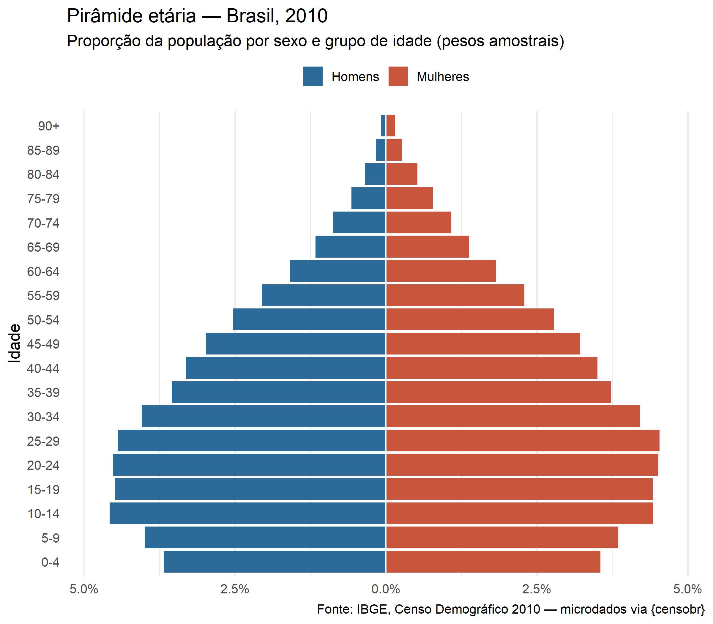
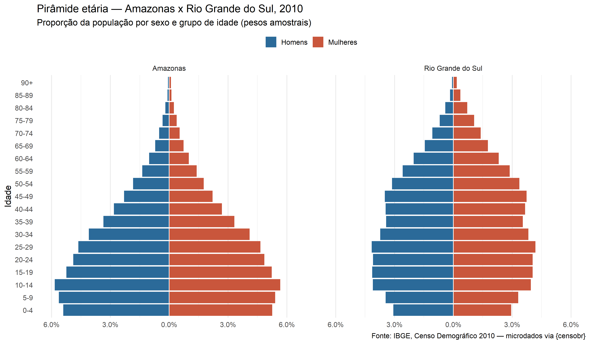
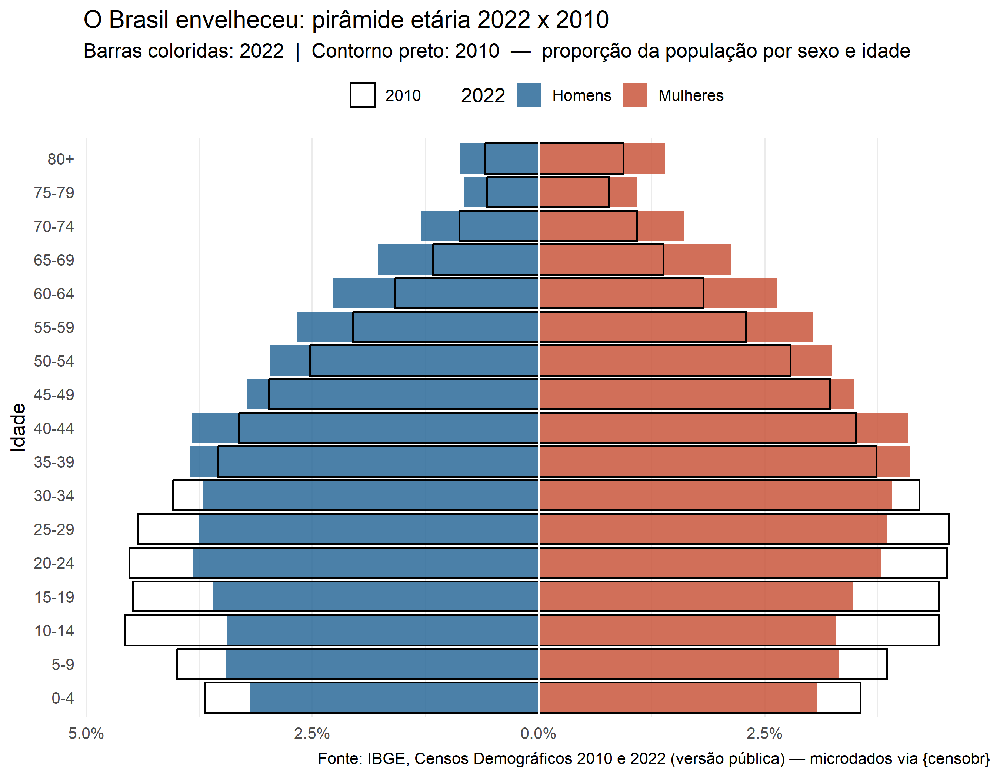

## O problema {.smaller}

O Censo é a base de dados mais importante do país. Mas usar os microdados do IBGE "na mão" exige:

- arquivos de **largura fixa**, um por UF
- dicionário em Excel e scripts de leitura em SAS/SPSS
- memória: o arquivo de pessoas de 2010 tem **20.635.472 linhas** e ~250 colunas

. . .

**Pergunta do trabalho:** como a estrutura etária do Brasil mudou entre 2010 e 2022?

## O pacote

- **Autores:** Rafael H. M. Pereira (mantenedor) e Rogério J. Barbosa — **Ipea**
- **Versão:** 1.0.0 (CRAN, 21/09/2026)
- **Cobertura:** Censos de **1960, 1970, 1980, 1991, 2000, 2010 e 2022**
- **Entrega:** microdados, agregados por setor censitário e documentação
- Mesmo autor do **{geobr}**: colunas geográficas com os mesmos nomes
  (`code_muni`, `code_state`, `abbrev_state`, `code_weighting`…)

```r
install.packages("censobr")
library(censobr)
```

## Como funciona por dentro

```
 Dados brutos do IBGE
        │  processados pelos autores
        ▼
 Arquivos Parquet (zstd) ── GitHub Releases: ipea/censobr_prep_data
        │  read_*() baixa UMA vez
        ▼
 Cache local versionado  ── get_censobr_cache_dir()
        │  abre sem carregar
        ▼
 Objeto Arrow  ──►  dplyr (lazy)  ──►  collect()  ──►  tibble pequeno
```

## Microdados (amostra)

| Função | 1960 | 1970 | 1980 | 1991 | 2000 | 2010 | 2022 |
|---|:-:|:-:|:-:|:-:|:-:|:-:|:-:|
| `read_population()` | ✓ | ✓ | ✓ | ✓ | ✓ | ✓ | ✓ |
| `read_households()` | ✓ | ✓ | ✓ | ✓ | ✓ | ✓ | ✓ |
| `read_families()`   |   |   |   |   | ✓ |   | ✓ |
| `read_mortality()`  |   |   |   |   |   | ✓ | ✓ |
| `read_emigration()` |   |   |   |   |   | ✓ |   |

Todas com a **mesma interface**:

```r
read_population(year, columns = NULL, add_labels = NULL, as_data_frame = FALSE,
                showProgress = TRUE, cache = TRUE, verbose = TRUE,
                merge_households = FALSE)
```

## Setores censitários e documentação {.smaller}

**Agregados do universo** — `read_tracts(year, dataset)` para 2000, 2010 e 2022

```r
read_tracts(year = 2022, dataset = "Pessoas")   # Basico, Domicilio, Entorno, Indigenas...
```

**Documentação** — baixa, guarda no cache e abre

```r
data_dictionary(year = 2010, dataset = "microdata")   # ou "tracts"
questionnaire(year = 2010, type = "long")             # ou "short"
interview_manual(year = 2010)
```

**Cache e suporte**

```r
censobr_cache(list_files = TRUE, print_tree = TRUE)   # delete_file = "all" / "old"
get_censobr_cache_dir();  set_censobr_cache_dir("D:/censo")
import_microdata22(zip_path = "...")                  # microdados controlados de 2022
```

## Argumentos que fazem diferença {.smaller}

| Argumento | O que faz |
|---|---|
| `year` | **obrigatório** (na 1.0.0 nenhuma função tem ano padrão) |
| `columns` | lê só as colunas pedidas — menos memória (o download continua inteiro) |
| `add_labels = "pt"` | troca códigos por rótulos: `1` → `"Masculino"` |
| `as_data_frame` | `FALSE` (padrão) = Arrow; `TRUE` = tudo na memória |
| `merge_households` | junta variáveis do domicílio (exige `columns`; usa DuckDB) |
| `cache` | `TRUE` reaproveita o arquivo baixado |

## Conceito 1: dados maiores que a memória

```r
pop <- read_population(year = 2010, columns = c("V0010", "V0601", "V6036"))
class(pop)
#> "arrow_dplyr_query"          ← não é data.frame: nada foi carregado ainda

pop |>
  group_by(V0601) |>
  summarise(pop = sum(V0010))   # ← só um PLANO de consulta (lazy)

  ... |> collect()              # ← agora executa e traz 2 linhas para o R
```

- O Parquet é **colunar**: ler 3 de 250 colunas lê só essas 3
- 20,6 milhões de linhas agregadas num notebook comum

## Conceito 2: amostra e peso amostral

Os microdados vêm do **questionário da amostra**: cada linha representa várias pessoas.

```r
pop |> summarise(linhas = n(), populacao = sum(V0010)) |> collect()
#>     linhas  populacao
#>   20635472  190755799     ← população oficial do Censo 2010
```

. . .

**Sem o peso, a pirâmide estaria errada.**

Os dados de setor (`read_tracts`) são do **universo**: já são totais, sem peso.

## O código — 1. leitura

```r
library(censobr); library(arrow); library(dplyr); library(ggplot2)

pop <- read_population(
  year    = 2010,
  columns = c("abbrev_state", "V0010", "V0601", "V6036")
)
```

| Variável | Significado |
|---|---|
| `V0010` | peso amostral |
| `V0601` | sexo (1 = masculino, 2 = feminino) |
| `V6036` | idade em anos |
| `abbrev_state` | UF (criada pelo censobr, padrão geobr) |

## O código — 2. agregação (roda no Arrow)

```r
calcular_piramide <- function(dados, uf = NULL) {
  if (!is.null(uf)) dados <- filter(dados, abbrev_state == uf)

  dados |>
    mutate(
      faixa = if_else(V6036 >= 90, 90, floor(V6036 / 5) * 5),  # grupos de 5 anos
      sexo  = if_else(V0601 == 1, "Homens", "Mulheres")
    ) |>
    group_by(sexo, faixa) |>
    summarise(pop = sum(V0010), .groups = "drop") |>          # soma dos PESOS
    collect() |>                                              # 38 linhas
    mutate(prop = pop / sum(pop))
}
```

## O código — 3. o gráfico

O truque: **homens com valor negativo**, rótulos em valor absoluto.

```r
ggplot(tab, aes(x = if_else(sexo == "Homens", -prop, prop),
                y = faixa, fill = sexo)) +
  geom_col(width = 0.9) +
  scale_x_continuous(labels = \(x) scales::percent(abs(x))) +
  scale_fill_manual(values = c(Homens = "#2b6a99", Mulheres = "#c9563c"))
```

Mesma função para qualquer UF: `calcular_piramide(pop, uf = "AM")`

## Brasil, 2010

{fig-align="center" height="600"}

## Duas fases da transição demográfica

{fig-align="center" height="560"}

Amazonas: base larga, população jovem · Rio Grande do Sul: base estreita, envelhecimento avançado

## O Brasil envelheceu

{fig-align="center" height="600"}

## Em números

| Indicador | 2010 | 2022 |
|---|--:|--:|
| 0–14 anos | 24,1% | 19,8% |
| 15–64 anos | 68,5% | 69,3% |
| 65+ anos | 7,4% | 11,0% |
| **Idosos por 100 jovens** | **30,7** | **55,5** |

Em 12 anos, o Brasil quase **dobrou** o número de idosos por jovem.

## E os microdados de 2022? {.smaller}

- A amostra de 2022 é distribuída pelo IBGE como **dados controlados** — o censobr não pode redistribuir
- Sem ela, `read_population(year = 2022)` **avisa** e usa a **versão pública** (idade só em grupos, `P0180`)
- Com o zip pedido em microdados.ibge.gov.br, importa **uma vez**:

```r
import_microdata22(zip_path = "arquivo_do_ibge.zip")
read_population(year = 2022)    # agora lê a versão completa, do cache
```

No nosso gráfico usamos a versão pública: peso `P0110`, sexo `P0150`, grupo de idade `P0180`.

## Cuidados e limitações

- Variáveis **não** são harmonizadas entre anos — só a geografia (sempre olhar `data_dictionary()`)
- O pacote não calcula **erros-padrão**: usar {survey}/{srvyr} com o desenho amostral
- Censo 1960 é incompleto (16 UFs na amostra de 25%) — o pacote avisa
- **1.0.0 trouxe breaking changes:** `year` obrigatório, `columns` só com nomes,
  códigos agora são inteiros (`V0601 == 1`, não `"1"`)

## Obrigado!

Código: `R/01_piramide_2010.R` e `R/02_piramide_2010_x_2022.R`

Pereira RHM, Barbosa RJ (2023). *censobr: Download Data from Brazil's Population Census*.
doi:10.32614/CRAN.package.censobr

<https://ipea.github.io/censobr/>

**Perguntas?**
